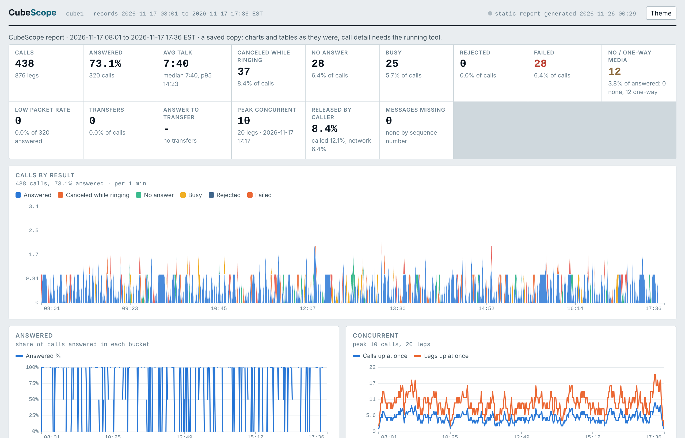

# CUCMStudio

> **This repository is a copy of [CUBEScape](https://github.com/jcliff01/CUBEScape).** Its code is the same as CUBEScape's, apart from the manual, which is only in CUBEScape. Use CUBEScape for the download, the manual and instructions.

**Project credit:** My coworker [Bastian74](https://github.com/Bastian74), whom I follow on GitHub, conceived and created this tool. I use it.

The program here is CubeScope: it turns the call records a Cisco CUBE writes into a dashboard in your web browser. It runs on Windows only.

## Download

Open the **[latest release](https://github.com/jcliff01/CUCMStudio/releases/latest)** and download **CubeScope.exe** (a release appears after the next change is merged). Or get it, with its manual, from [CUBEScape's releases](https://github.com/jcliff01/CUBEScape/releases/latest).

Double-click CubeScope.exe, pick the folder that holds your CUBE's log files, and the dashboard opens at http://localhost:8792/. Keep the console window open while you use it. If Windows says it protected your PC, click **More info**, then **Run anyway**. Full steps are in [CUBEScape's README](https://github.com/jcliff01/CUBEScape#readme).

## Build it yourself (developers)

On Windows, in this folder, run `build.bat test`. It builds `bin\CubeScope.exe` with the C# compiler built into Windows and runs the self-test, which should end with `0 failed`.

## License

There is no published reuse license for this code. Ask the author before redistributing it.
